<div align="center">

<a href="https://arushhh.com"></a>

[![arushhh.com][b-web]][l-web][![CV][b-cv]][l-cv][![Email][b-mail]][l-mail][![GitHub][b-gh]][l-gh][![LinkedIn][b-in]][l-in][![Hugging Face][b-hf]][l-hf][![X][b-x]][l-x]

</div>

```console
arush@dhanbad:~$ cat now.txt
role     : research engineer intern, Conscious Engines
           Stackr Labs, backed by a16z
now      : draft-aligned decoding for a 30B diffusion MoE LM
           training FLARE-2B on 8×H200
focus    : inference efficiency, decoding, post-training
school   : final-year ECE, IIT (ISM) Dhanbad
based    : New Delhi, IST
open to  : research engineering roles from mid-2027,
           internships before then
```

```diff
arush@dhanbad:~$ cat highlights.txt
+ 1.35×       faster decoding on a 30B diffusion LM
+ 1st         Best Paper, IBM Research 2026
+ 5th/80,000  Amazon ML Challenge 2026, public leaderboard
```

```console
arush@dhanbad:~$ ls papers/  # open a row: method, my part, numbers
```

<details>
<summary><b>Sign-hedged Beam QAOA</b> &nbsp;<code>Best Paper Award</code><br><sub>IBM Research Internship Symposium 2026 · approximation ratio 1.000 on IBM Marrakesh hardware</sub></summary>

#### Sign-hedged Beam QAOA: Scaling Quantum Optimization Algorithms
**Arush Sharma**, Anupama Ray · manuscript in preparation

> Recursive QAOA keeps making irreversible sign errors in its correlators; hedging both signs with a small beam and an evolved power-law schedule removes them.

`method` A multi-agent loop proposed, mutated, critiqued and evaluated analytic QAOA schedules, evolving the linear ramp into a fixed power-law schedule. The schedule then drives a width-*B* sign-hedged beam over the recursive eliminations, evaluated on simulators, MPS and IBM hardware.

`my part` The algorithm-discovery loop, the beam-hedged recursion, and the simulator, MPS and hardware evaluations.

`numbers`

```diff
+ 0.998  approximation ratio, SK model n=20, simulation,
         2.1× over baseline
+ 1.000  on IBM Marrakesh hardware
+ 0.984  MaxCut n=60, 17.6% above QAOA
+ 0.983  20-asset portfolio, 26% above RQAOA
```

[Best Paper certificate](https://arushhh.com/assets/ibm-best-paper-award.jpg)

</details>

<details>
<summary><b>PACL</b> &nbsp;<code>WACV 2027 · under review</code><br><sub>first author · 0.987 chest X-ray AUROC, +2.0 pts over prior best</sub></summary>

#### From Points to Distributions: Probabilistic Latent Autoregression for Medical Image Representation Learning
**Arush Sharma**, Soumen Basu, Manoj Kumar

> PACL predicts a Gaussian latent per image patch instead of a point, and carries that uncertainty into classification and segmentation.

`method` A masked causal ViT with a distributional head predicts the latent distribution of future patches, trained with a β-NLL against frozen target embeddings. At fine-tuning time the predicted variance becomes an uncertainty score that modulates the classification and segmentation losses.

`my part` The mean/variance and anti-collapse losses, and the chest X-ray and ultrasound experiments.

`numbers`

```diff
+ 0.987  chest X-ray AUROC, +2.0 pts over prior best
+ 0.938  BUSI breast-ultrasound AUROC, +2.1 pts
+ 0.604  segmentation IoU, +1.3 pts
```

[PDF](https://arushhh.com/assets/papers/pacl-wacv2027.pdf)

</details>

<details>
<summary><b>BrainRMA</b> &nbsp;<code>AAAI 2027 · under review</code><br><sub>second author · 82.35% accuracy on ABIDE, +3.35 pts over prior best</sub></summary>

#### BrainRMA: ROI-Preserving Multiscale Attention for Brain Network Analysis
second author, with Soumen Basu and Manoj Kumar

> Keeps one token per brain region instead of pooling regions away, and fuses global attention with reliability-weighted region-to-cluster context.

`method` A subject-specific brain graph is built from functional connectivity. A position-aware long-range encoder keeps every region's token, while a module-aware branch learns cluster context and fuses it back through a reliability-weighted gate, so regional identity survives to the readout.

`my part` The ablation suite, and co-writing the methodology and experiments.

`numbers`

```diff
+ 82.35%  accuracy on ABIDE, +3.35 pts over prior best
+ 93.75%  accuracy on OSF, +6.25 pts
```

[PDF](https://arushhh.com/assets/papers/brainrma-aaai2027.pdf)

</details>

```console
arush@dhanbad:~$ git log --oneline work/
Aug 2026–now  Conscious Engines   1.35× decoding, 30B diffusion LM
May–Aug 2026  IBM Research India  Best Paper Award, AI for quantum
Jun 2025–now  IIT (ISM) Dhanbad   PACL + BrainRMA, under review
Jun–Nov 2025  Aeroqube            MedGemma 4B on AWS with RAG
```

```diff
arush@dhanbad:~$ git show HEAD
    draft-aligned decoding for SDAR-30B-A3B, a 30B-parameter
    diffusion mixture-of-experts LM: a 1.7B drafter pre-fills
    each 32-token block, a self-distilled LoRA judge accepts
    or re-masks each token

@@ vs the 30B model's own block decoding @@
- 12.8   large-model passes per block
+  7.6   large-model passes per block, 1.68× fewer
+ 1.35×  throughput at comparable accuracy
!        gap from 1.68× to 1.35×: drafter and judge overhead
```

Also training FLARE-2B, a Qwen3.5-2B model converted to diffusion decoding, through 9.66B tokens on 8×H200 with resumable checkpoints. The code is internal; I am glad to walk through the method and the ablations.

<details>
<summary><code>git log work/</code> &nbsp;full entries: role, advisors, stack</summary>

#### Conscious Engines · Aug 2026 – now
Research Engineer Intern (Stackr Labs, backed by a16z). Draft-aligned decoding for SDAR-30B-A3B and FLARE-2B training, above.\
`diffusion LMs` `speculative decoding` `LoRA` `DDP/FSDP` `H200`

#### IBM Research India · May – Aug 2026
Research Intern, AI for Quantum, with Dr. Anupama Ray. Built a multi-agent loop in which model agents proposed, mutated, critiqued and evaluated analytic QAOA schedules; used the best schedule in sign-hedged beam RQAOA and evaluated it on simulators, MPS and IBM hardware. The work won the Best Paper Award at the internship symposium.\
`QAOA` `beam search` `agentic search` `IBM Quantum`

#### IIT (ISM) Dhanbad · Jun 2025 – now
Research Intern, with Dr. Soumen Basu (Meta) and Dr. Manoj Kumar (IIT Roorkee). Uncertainty-aware self-supervised learning for medical images and graph models of brain networks. First author on PACL, second author on BrainRMA.\
`self-supervised learning` `ViT` `graph models`

#### Aeroqube · Jun – Nov 2025
Agentic AI Intern. Fine-tuned MedGemma 4B for a medical-tourism assistant and deployed it as a Dockerized AWS pipeline with retrieval-augmented generation and LangSmith evaluation.\
`MedGemma` `RAG` `AWS`

</details>

```console
arush@dhanbad:~$ ls projects/
```

| project | what | result |
| :-- | :-- | :-- |
| [PriorityKV](https://github.com/Arush777/Priority_KV) | Structure-aware KV-cache eviction for long agent traces | **112/120** vs 1/120 |
| [Business entity resolution](https://github.com/NoviceCoderInfinity/clauders) | Amazon ML Challenge 2026: cost-tiered cascade over 1.7M business records | **5th** of 80,000 |
| [AlignmentLab](https://github.com/Arush777/AlignmentLab) | Matched-compute SFT, DPO and GRPO/RLVR on Qwen3-8B and 14B: does RLVR add capability, or only sharpen sampling? | post-training |
| [Arista Intelligent RRM](https://github.com/HappySaxena/Arista_High_Prep_InterIIT_14.0) | Inter IIT Tech Meet 14.0: learns Wi-Fi channel, power and bandwidth with a GNN and offline RL; edge-client throughput +18% | **12th** of 23 IITs |
| [ReVival](https://github.com/Arush777/ReVival) | Seven agents grade returned products from photos or video; I built the FastAPI backend | Amazon HackOn S6 |
| [Hindi TinyStories GPT](https://github.com/Arush777/hindi-tinystories-gpt) | Decoder-only transformer (RoPE, RMSNorm, SwiGLU) from scratch, ~100M Hindi tokens | **33M** params |
| [AtomMail](https://github.com/Arush777/my-hackfest-atom-mail) | Email assistant that reads threads and attachments via OCR and drafts replies in the user's tone | **2nd** prize, Hackfest |
| [DeepLense](https://github.com/Arush777/Deeplense_GSoC) | Physics-informed gravitational-lens classification, weights on Hugging Face | **0.9976** ROC-AUC |
| [Stanford CS336](https://github.com/Arush777/Language_Modeling-stanford-cs336) | Tokenizers, transformers and training loops implemented from the ground up | from scratch |

```diff
arush@dhanbad:~$ diff -u position-blind/ priority-kv/
@@ 15,360 generations · Qwen3-8B and Llama-3.1-8B @@
  protects system, tool-schema, constraint, sink and recent tokens
- position-blind eviction   task state kept    1/120
+ PriorityKV                task state kept  112/120
+ KV payload −28% · peak GPU memory −13%
! latency overhead 11–12%
```

```console
arush@dhanbad:~$ cat awards.txt
Aug 2026  Best Paper Award, IBM Research Internship Symposium
2026      5th of 80,000 teams, Amazon ML Challenge 2026
          public leaderboard
2025      12th of 23 IITs, Inter IIT Tech Meet 14.0
2025      2nd prize, Hackfest (AtomMail)
2025      Amazon ML Summer School, selected
          top 3,000 of 134,000 applicants
2023      All-India Rank 5181, JEE Advanced
          top 0.47% of 1.11 million candidates
arush@dhanbad:~$ cat education.txt
B.Tech, Electronics and Communication Engineering
IIT (ISM) Dhanbad · 2023 – April 2027 · CGPA 8.19 / 10
```

```console
arush@dhanbad:~$ cat toolbox.txt
daily    : Python, PyTorch, Hugging Face Transformers,
           TRL/PEFT, vLLM
training : SFT, DPO, GRPO/RLVR, LoRA/QLoRA, DDP/FSDP,
           Triton, KV-cache optimisation, quantisation
systems  : C/C++, SQL, CUDA, Docker,
           AWS (Bedrock, S3, DynamoDB), FastAPI, Next.js
```

```console
arush@dhanbad:~$ cat contact.txt
web      : https://arushhh.com
email    : arushsharma536@gmail.com
cv       : https://arushhh.com/assets/Arush_Sharma_CV.pdf
github   : https://github.com/Arush777
linkedin : https://www.linkedin.com/in/arush-sharma-44a796288
x        : https://x.com/Arushhh_Sharma
hf       : https://huggingface.co/Arushhh
arush@dhanbad:~$ ▌
```

[l-web]: https://arushhh.com
[l-cv]: https://arushhh.com/assets/Arush_Sharma_CV.pdf
[l-mail]: mailto:arushsharma536@gmail.com
[l-gh]: https://github.com/Arush777
[l-in]: https://www.linkedin.com/in/arush-sharma-44a796288
[l-hf]: https://huggingface.co/Arushhh
[l-x]: https://x.com/Arushhh_Sharma
[b-web]: https://img.shields.io/badge/-arushhh.com-121211?style=for-the-badge&labelColor=19c6a5&logo=data%3Aimage%2Fsvg%2Bxml%3Bbase64%2CPHN2ZyB4bWxucz0iaHR0cDovL3d3dy53My5vcmcvMjAwMC9zdmciIHZpZXdCb3g9IjAgMCAyNCAyNCIgZmlsbD0ibm9uZSIgc3Ryb2tlPSIjMTIxMjExIiBzdHJva2Utd2lkdGg9IjIuNCIgc3Ryb2tlLWxpbmVjYXA9InJvdW5kIiBzdHJva2UtbGluZWpvaW49InJvdW5kIj48Y2lyY2xlIGN4PSIxMiIgY3k9IjEyIiByPSI5LjgiLz48ZWxsaXBzZSBjeD0iMTIiIGN5PSIxMiIgcng9IjQuMyIgcnk9IjkuOCIvPjxwYXRoIGQ9Ik0yLjIgMTJoMTkuNiIvPjwvc3ZnPg%3D%3D
[b-cv]: https://img.shields.io/badge/CV-121211?style=for-the-badge&logo=data%3Aimage%2Fsvg%2Bxml%3Bbase64%2CPHN2ZyB4bWxucz0iaHR0cDovL3d3dy53My5vcmcvMjAwMC9zdmciIHZpZXdCb3g9IjAgMCAyNCAyNCIgZmlsbD0ibm9uZSIgc3Ryb2tlPSIjMTljNmE1IiBzdHJva2Utd2lkdGg9IjIuNCIgc3Ryb2tlLWxpbmVjYXA9InJvdW5kIiBzdHJva2UtbGluZWpvaW49InJvdW5kIj48cGF0aCBkPSJNMTQgMi4ySDYuMmEyIDIgMCAwIDAtMiAydjE1LjZhMiAyIDAgMCAwIDIgMmgxMS42YTIgMiAwIDAgMCAyLTJWOHoiLz48cGF0aCBkPSJNMTQgMi4yVjhoNS44Ii8%2BPHBhdGggZD0iTTguMyAxM2g3LjQiLz48cGF0aCBkPSJNOC4zIDE3aDUiLz48L3N2Zz4%3D
[b-mail]: https://img.shields.io/badge/email-121211?style=for-the-badge&logo=gmail&logoColor=19c6a5
[b-gh]: https://img.shields.io/badge/github-121211?style=for-the-badge&logo=github&logoColor=19c6a5
[b-in]: https://img.shields.io/badge/linkedin-121211?style=for-the-badge&logo=data%3Aimage%2Fsvg%2Bxml%3Bbase64%2CPHN2ZyB4bWxucz0iaHR0cDovL3d3dy53My5vcmcvMjAwMC9zdmciIHZpZXdCb3g9IjAgMCAyNCAyNCI%2BPHBhdGggZmlsbD0iIzE5YzZhNSIgZmlsbC1ydWxlPSJldmVub2RkIiBkPSJNNSAyaDE0YTMgMyAwIDAgMSAzIDN2MTRhMyAzIDAgMCAxLTMgM0g1YTMgMyAwIDAgMS0zLTNWNWEzIDMgMCAwIDEgMy0zek01LjMgNy4yYTEuNiAxLjYgMCAxIDAgMy4yIDBhMS42IDEuNiAwIDEgMC0zLjIgMHpNNS41IDEwaDIuOHY4SDUuNXpNMTAuMiAxMGgyLjd2MS4yYy41LS44IDEuNS0xLjQgMi43LTEuNCAyIDAgMi45IDEuMiAyLjkgMy40VjE4aC0yLjh2LTQuNGMwLTEuMS0uNC0xLjctMS4zLTEuNy0uOSAwLTEuNS42LTEuNSAxLjhWMThoLTIuN3oiLz48L3N2Zz4%3D
[b-hf]: https://img.shields.io/badge/hugging_face-121211?style=for-the-badge&logo=huggingface&logoColor=19c6a5
[b-x]: https://img.shields.io/badge/x-121211?style=for-the-badge&logo=x&logoColor=19c6a5
